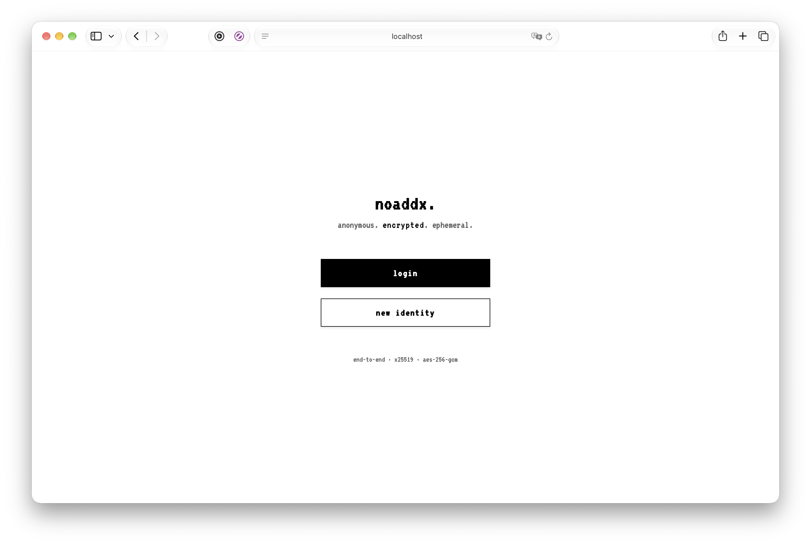
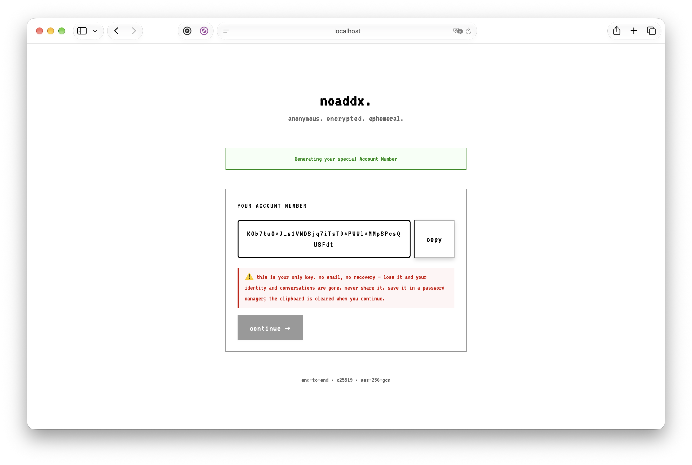

<p align="center">
  
</p>

<p align="center">
  <strong>Anonymous, zero-metadata, end-to-end encrypted messaging.</strong><br>
  No email · No phone number · No password · No username: one random 256-bit account number.
</p>

<p align="center">
  <a href="docs/security/cryptography.md"></a>
  <a href="https://go.dev/"></a>
  <a href="https://developer.mozilla.org/en-US/docs/Web/API/Web_Crypto_API"></a>
  <a href="https://www.postgresql.org/"></a>
  <a href="https://docs.docker.com/compose/"></a>
  <a href="LICENSE"></a>
</p>

<p align="center">
  
  
</p>

---

**noaddx.** is a browser-based messenger built to keep as little as possible about its users: an identity is one random 256-bit account number, every message is encrypted in the browser, and the server stores only padded ciphertext and pseudonyms it cannot link across conversations. It can be published as a Tor onion service without switching off a single server-side defense.

## Documentation

- **[Quick Start](docs/getting-started/quickstart.md)** — `make setup && make up`, then a two-party chat in a minute
- **[Installation & Platforms](docs/getting-started/installation-and-platforms.md)** — macOS, Linux, Windows (WSL2), arm64 vs amd64
- **[System Architecture](docs/architecture/system-overview.md)** — Data flow, identity derivation, database schema, identity deletion, retention
- **[Threat Model & Security](docs/security/threat-model.md)** — What each adversary sees, database dump resilience, known limitations
- **[Cryptography Specification](docs/security/cryptography.md)** — The two crypto engines, X25519 / HKDF / AES-256-GCM, five padding sizes, PoW
- **[Verifying the Client](docs/security/verifying-the-client.md)** — Signed frontend manifest per release and `make verify-frontend`
- **[REST API Reference](docs/api/rest-api.md)** — Every `/api/v2/*` endpoint with its JSON, error codes and Server-Sent Events
- **[Configuration & Tuning](docs/operations/configuration-and-tuning.md)** — Every environment variable, master key rotation, Argon2id memory tuning
- **[Onion Service (Tor)](docs/operations/onion-service.md)** — `make onion`, per-circuit abuse control, onion key custody
- **[Troubleshooting](docs/troubleshooting/troubleshooting-guide.md)** — Common errors with copy-paste fixes
- **[Testing & Development](docs/development/testing-and-contributing.md)** — Test suites, fuzzing, CI, lock hierarchy
- **[SECURITY.md](SECURITY.md)** — How to report a vulnerability, supported versions and scope
- **[CHANGELOG.md](CHANGELOG.md)** — Notable changes, with every security fix listed explicitly

## Features

- **Zero-Knowledge Identity:** an identity is a single 256-bit CSPRNG `AccountNumber`. The server shows it once at signup and never stores it; the browser derives the login key and the X25519 identity from it.
- **Client-Side E2E Encryption:** messages are encrypted in the browser with WebCrypto (X25519 + HKDF-SHA256 + AES-256-GCM) and padded to one of five sizes (256 to 4096 bytes); the server accepts no other size.
- **Graph Unlinkability:** every participant has a distinct HMAC tag per conversation, so even a full database dump cannot tell whether one user is in two conversations.
- **Erasable by Design:** messages expire after `MESSAGE_TTL_DAYS` (default 7), **burn** erases a conversation for both sides, and **delete** erases a whole identity, re-proven by its account number.
- **Anonymous Transport:** `make onion` publishes the app as a Tor onion service. Rate limits, proofs of work (registration and every invite) and connection caps apply per Tor circuit.
- **Verifiable Client:** each release signs the hashes of every frontend file; `make verify-frontend` checks what an instance serves.
- **Zero Telemetry:** no access logs, no stored IP addresses, master keys zeroized on shutdown.
- **Two Equivalent Crypto Engines:** the backend builds against OpenSSL (default) or the Go standard library (`ENGINE=native`), proven byte-for-byte equivalent by a differential suite and a startup self-test.

## Quick Start

```bash
make setup    # .env with fresh secrets (any openssl, LibreSSL included), mode 0600
make up       # build and start; open http://localhost
```

```bash
make onion            # optional: the same, also published as a Tor onion service
make onion-address    # its .onion address, about a minute after the first start
```

> [!CAUTION]
> **WebCrypto Secure Context Requirement:** Always access via `http://localhost` or `http://127.0.0.1`. Modern browsers automatically disable `window.crypto.subtle` on unencrypted remote IP addresses (`http://192.168.x.x`), which prevents key derivation and messaging. For remote server deployments, TLS/HTTPS termination is mandatory (or the onion service, which Tor Browser treats as secure).

---

## Protocol & Mechanics

### 1. Zero-Knowledge Identity Derivation

```text
AccountNumber (256-bit CSPRNG, base64url, 43 chars) - generated at signup, shown ONCE
   |
   +-- HKDF-SHA256(salt: "noaddx.v1", info: "noaddx/auth") -----------> auth key (sent at login)
   |                                                                          server keeps HMAC + Argon2id only
   `-- HKDF-SHA256(salt: "noaddx.v1", info: "noaddx/identity/x25519") -> X25519 identity (stays in browser)
                                                                             server keeps the public key only
```

Both Go (`backend/internal/identity`) and JavaScript (`frontend/js/crypto.js`) implement this exact derivation and are tested byte-for-byte against each other (`node --test frontend/tests/*.test.mjs`, `backend/tests/identity`).

In the browser, the private key is imported into IndexedDB as a **non-extractable** `CryptoKey`. Script running on the page can execute cryptographic operations, but cannot read or export raw private key bytes.

### 2. Pairing & Out-of-Band Fingerprinting

```text
Alice (Creator)                         Server                                   Bob (Redeemer)
  | POST /api/v2/invites {pow} --------> | stores HMAC(token) +                   |
  |                                      | AES-GCM(creator_uuid, master_key)      |
  |<---------------------------- token   |                                        |
  | code = "noaddx:" + b64url(token || SHA-256("noaddx/invite-fp" || token || alicePub)[0:16])
  | ---------------- out of band (Signal, paper, in person) --------------------->|
  |                                      | <----------------- POST /api/v2/invites/redeem {token}
  |                                      | atomically deletes invite, creates conversation
  |<--- SSE "conv"                       | --------------------------------------> alicePub
  |                                      |       Bob checks alicePub against the code's
  |                                      |       fingerprint; mismatch ---> auto-burn!
```

The fingerprint never touches the server. Because it binds to the single-use token, two invites created by the same person share no bytes. Every invite costs a fresh, single-use proof of work.

### 3. Message Framing & AAD Binding

```text
conversation key = HKDF-SHA256(X25519(myPriv, peerPub), salt: conversation_id, info: "noaddx/conv/v1")
plaintext        = len(2) || {"t": text, "ts": sentAt, "n": counter} || zero padding to 256, 512, 1024, 2048 or 4096 bytes
AAD              = "NADM" || 0x01 || conversation_id(16) || message_id(16) || SHA-256(sender_pub)(32)
wire             = base64url(nonce(12) || AES-256-GCM(plaintext, AAD) || tag(16))
```

The message ID is a client-generated UUIDv4 bound into the AAD. A ciphertext cannot be moved to another room, replayed under a different message ID, or reflected back as originating from the other participant.

### 4. Realtime Server-Sent Events (SSE)

`GET /api/v2/events` provides an unbuffered stream of content-free pokes (`event: msg` with conversation ID, `event: conv` for membership changes). Clients refetch content through authorized REST endpoints. Open streams close immediately on logout, identity deletion or server shutdown.

---

## Security Model & Database Invariants

| Table | Columns Stored | Readable Without Master Key / Pepper? |
|---|---|---|
| `users` | `uuid`, `account_lookup`, `account_hash`, `public_key`, `session_epoch`, `encrypted_key`, `master_key_id`, `conv_index_enc` | **Public key only**. Account number cannot be derived. No creation or update timestamps exist. |
| `invites` | `lookup` (HMAC), `creator_ref_enc` (AES-GCM), `master_key_id`, `expires_at` | **Expiry timestamp only**. Token and creator reference are unreadable. |
| `conversations` | `id` (UUIDv4) | Room ID exists; participants remain completely anonymous. |
| `conversation_members` | `conversation_id`, `member_tag` (HMAC per room), `member_ref_enc` (AES-GCM), `master_key_id`, `peer_key_enc` (AES-GCM), `read_seq` | **Read sequence only**. Member tags are unique per room; cross-room correlation is impossible. |
| `messages` | `conversation_id`, `seq` (per-room atomic counter), `id` (UUIDv4), `sender_tag`, `ciphertext`, `expires_on` (UTC day) | **Nothing about content**. Every ciphertext has one of five padded sizes; ordering is scoped to the room. |

### Memory Zeroization on Shutdown
Upon receiving `SIGINT` or `SIGTERM`, the server halts incoming connections, cleanly drains in-flight requests, terminates SSE streams, and executes `encryption.ZeroizeAllKeys()` to overwrite master keys in memory with zeros.

---

## Makefile Targets & Testing

The project uses a standard `Makefile` for container management and test automation:

```bash
# Manage containers
make setup        # Generate .env with fresh cryptographic keys
make build        # Build Docker service images (ENGINE=openssl by default, or ENGINE=native)
make up           # Start all services in the background (same ENGINE choice)
make onion        # Like up, and publish the app as a Tor onion service (opt-in)
make onion-address # Print the .onion address
make down         # Stop and remove containers (tor included)
make restart      # Restart containers
make logs         # Tail live container logs
make ps           # Check container status
make clean        # Remove this project's containers, volumes (onion key included), images and test artifacts

# Run test suites
make test         # Complete Go suite (incl. database + integration) for ENGINE against a disposable PostgreSQL
make test-engines # The complete suite for both engines
make test-equivalence # Prove openssl and native give byte-identical results
make test-run     # Test first; if passed, start services
make test-unit    # Run Go unit tests locally (no database required)
make test-crypto  # Run frontend WebCrypto derivation tests (Node.js 20+)
make test-all     # Run both Go unit tests and frontend crypto tests
make test-db      # Database + integration tests against a local PostgreSQL (TEST_DB_* overrides)

# Releases (both engines are tested first)
make release VERSION=v1.0.0           # on main: tags noaddx-openssl-v1.0.0 and noaddx-native-v1.0.0
make tag-dev                          # on noaddx-dev: moves noaddx-openssl-dev / noaddx-native-dev
make build-ref REF=noaddx-native-v1.0.0  # build the image of any tag or commit

# Verifying a deployment
make manifest                         # SHA-256 of every served frontend file (signed in each release)
make verify-frontend URL=https://host # check an instance serves exactly those bytes
```

---

## Built On

| Standard | Used for |
|---|---|
| [X25519 · RFC 7748](https://www.rfc-editor.org/rfc/rfc7748) | Identity keys and the per-conversation key agreement |
| [HKDF-SHA-256 · RFC 5869](https://www.rfc-editor.org/rfc/rfc5869) | Deriving the auth key, identity key and conversation keys |
| [AES-256-GCM · NIST SP 800-38D](https://csrc.nist.gov/pubs/sp/800/38/d/final) | Messages in the browser, sensitive columns at rest |
| [HMAC-SHA-256 · RFC 2104](https://www.rfc-editor.org/rfc/rfc2104) | Account lookup and per-conversation pseudonyms |
| [Argon2id · RFC 9106](https://www.rfc-editor.org/rfc/rfc9106) | Hashing the auth key on the server |
| [JWT · RFC 7519](https://www.rfc-editor.org/rfc/rfc7519) | HS256 session token, HttpOnly cookie only |
| [PKCS #8 for X25519 · RFC 8410](https://www.rfc-editor.org/rfc/rfc8410) | Importing the derived key as a non-extractable `CryptoKey` |
| [Base64url · RFC 4648 §5](https://www.rfc-editor.org/rfc/rfc4648#section-5) | Account numbers, keys, invite codes, ciphertext |
| [Web Cryptography API](https://www.w3.org/TR/WebCryptoAPI/) · [Trusted Types](https://w3c.github.io/trusted-types/dist/spec/) | All browser cryptography; DOM-injection sinks locked by CSP |
| [OpenSSL 3](https://docs.openssl.org/3.5/man7/crypto/) · [Go crypto](https://pkg.go.dev/crypto) | The two interchangeable server engines (byte-for-byte equivalent) |
| [Tor onion services v3](https://spec.torproject.org/rend-spec/) | Anonymous transport (`make onion`), circuit IDs via the [HAProxy PROXY header](https://spec.torproject.org/haproxy-proxy.html) |
| [Sigstore](https://docs.sigstore.dev/) | Keyless signature of each release's frontend manifest |

## License

noaddx. is free software under the [GNU Affero General Public License v3.0](LICENSE). Run a modified version as a network service, and you must offer its users the source.

<br>

<p align="center">
  <sub><b>noaddx.</b> · no email · no phone · no address</sub>
</p>
